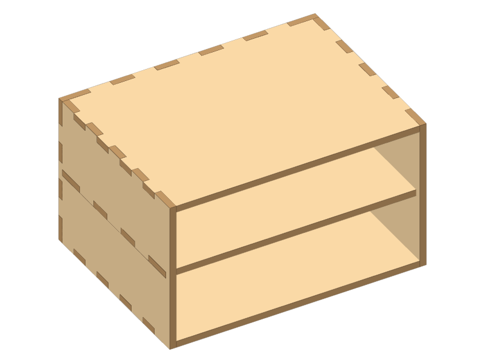
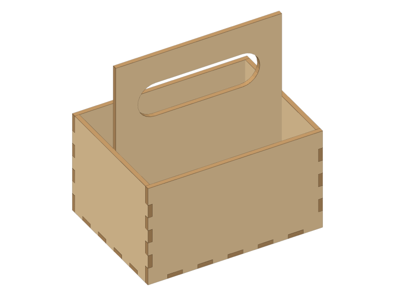
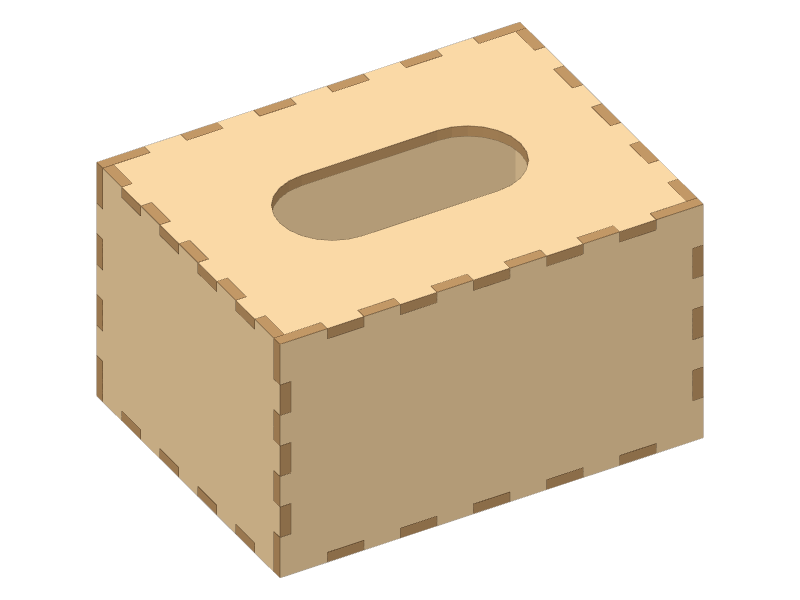

# Shared box styles for Boxsmith

New box styles for [Boxsmith](https://github.com/markplaga/Boxsmith), the laser-cut box generator, shared by the people who made them. Each one is a **box type file**: JSON that describes the parts, their sizes and how they join, with formulas but no code, so it is safe to open.

Every style here has been built by Boxsmith at many sizes and settings and checked in 3D: every finger meets a matching gap, and no two parts run into each other. That check runs again on every change.

## Use one

In Boxsmith, click **Type lab** at the end of the Box style list, then **Shared types**. Pick a style and click **Install**. It joins your style list under My types, with its own settings in the sidebar.

You can also download a `type.json` from below and open it in the Type lab.

## The styles

<!-- gallery:start -->
| | Style | By | File |
| --- | --- | --- | --- |
|  | **Box with a shelf**<br>`box-with-shelf`<br>Open front cubby with a slotted-in shelf<br>Settings: Shelf height (% of inside) | Boxsmith<br>v1.0.0 | [type.json](types/box-with-shelf/type.json) |
|  | **Caddy**<br>`caddy`<br>Open tray with a tall carrying handle down the middle<br>Settings: Handle above the walls, Hand-hold length | Boxsmith<br>v1.0.0 | [type.json](types/caddy/type.json) |
|  | **Tissue box**<br>`tissue-box`<br>Closed box with a pull slot in the top<br>Settings: Slot length (% of the top), Slot width | Boxsmith<br>v1.0.0 | [type.json](types/tissue-box/type.json) |
<!-- gallery:end -->

## Share yours

1. Make the style in Boxsmith's Type lab, check it and save it to My types. ([The format](https://github.com/markplaga/Boxsmith/blob/main/BOX-TYPES.md); the Type lab can write you a prompt for an AI.)
2. Click **Share** next to it under My types. GitHub opens with the file ready as `types/<id>/type.json`; propose the change and open a pull request. (Or add the folder yourself in a pull request.)
3. The check runs on your pull request. If it finds problems, each message says which setting and which part; fix them in the Type lab and update the file.
4. Once it's merged, the preview picture and the list above are made automatically, and the style appears under Shared types in Boxsmith.

**What a shared style needs**

- A folder `types/<id>/` named after the type's `id`, holding `type.json` and, if you like, a `README.md` with notes or photos. Nothing else (`preview.png` is made for you).
- `author`, `description` and `typeVersion` filled in. Raise `typeVersion` when you change a style.
- An `id` that isn't a built-in Boxsmith style or another shared one.
- It must fit at every setting the check tries: small (60 × 50 × 40 mm) and large (400 × 300 × 250 mm) boxes, 6 mm material, inside measurements, each corner style, screw joints (unless `"screws": false`), and each of its own settings at its smallest, largest and every choice. A style may decline a size it can't make by giving a warning and no parts.
- A license in `license` if you want one other than the default below.

## Check locally

```
git clone https://github.com/markplaga/markplaga-boxsmith-type
cd markplaga-boxsmith-type
git clone https://github.com/markplaga/Boxsmith boxsmith
npm install
npm run check                    # all types
node tools/check.js caddy        # just one
npm run build                    # also writes index.json, previews and the list above (needs Chrome)
```

`index.json` lists every style that passes, for Boxsmith and other tools: `{format: "boxsmith-type-index", version: 1, types: [{id, name, description, author, typeVersion, license, file, preview, readme, params, parts}]}`. Paths are relative to this repository.

## License

The tools are MIT. Box styles are [CC BY 4.0](https://creativecommons.org/licenses/by/4.0/) unless their `license` says otherwise: use, change and sell what you cut, and credit the author when you share the style itself.
